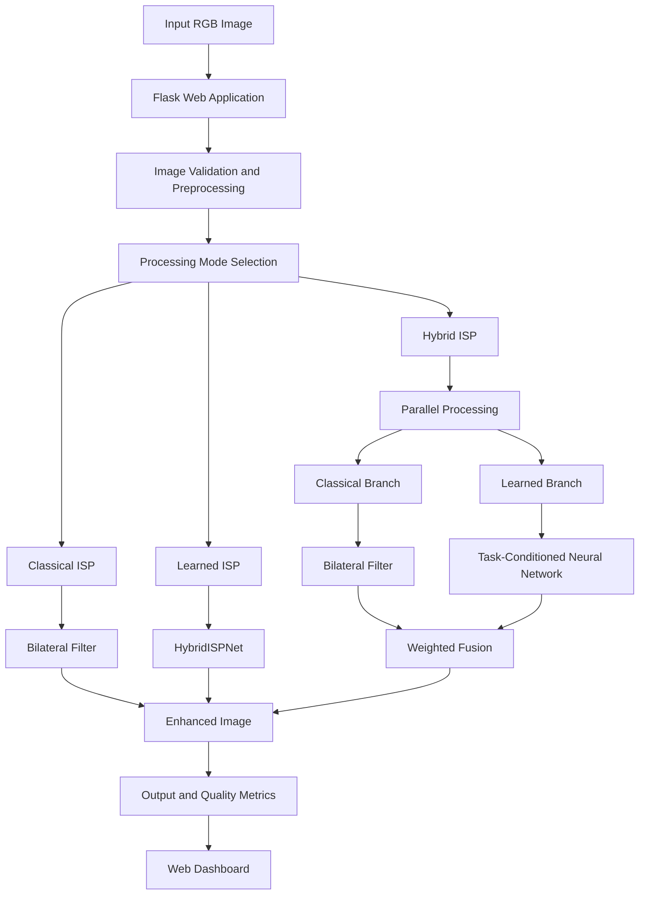

# HybridISP — System Architecture

**Problem Statement:** P2 — Intelligent and Computationally Efficient Smartphone ISP  
**Team ID:** T90

## 1. System Overview

HybridISP is a hybrid image enhancement system that combines a classical computer vision pipeline with a task-conditioned deep learning model.

The system provides three processing modes:

1. **Classical ISP:** Uses a bilateral filter for edge-preserving smoothing.
2. **Learned ISP:** Uses HybridISPNet to perform task-conditioned image enhancement.
3. **Hybrid ISP:** Combines the learned and classical outputs through weighted fusion.

The application accepts an RGB image, processes it through the selected pipeline, and returns the enhanced image through a Flask web interface.

## 2. High-Level Architecture

## 3. Detailed Architecture Components

### 3.1 Input Layer

- Accepts user-uploaded RGB images.
- Validates the uploaded file and image format.
- Converts image data into the expected numerical representation.
- Normalizes pixel values to the range [0, 1].

### 3.2 Classical ISP Branch

The classical processing branch uses OpenCV bilateral filtering.

**Technique:** Bilateral Filter

**Purpose:**
- Reduces image noise.
- Preserves edges better than ordinary Gaussian smoothing.
- Provides a conventional image-processing baseline.

### 3.3 Learned ISP Branch

The learned branch uses a custom task-conditioned convolutional neural network named HybridISPNet.

**Model characteristics:**
- Implemented using PyTorch.
- Approximately 3.09 million parameters.
- Uses task conditioning for different image-processing objectives.
- Supports tiled inference to process high-resolution images in smaller regions.
- Uses a trained model checkpoint stored in `models/best_model.pth`.

The current training tasks are:

- SIDD: Image denoising.
- FiveK: Image enhancement.

### 3.4 Hybrid Fusion Layer

The hybrid pipeline combines the outputs from the classical and learned branches.

The current default fusion equation is:

\[
I_{hybrid} =
0.85I_{learned} + 0.15I_{classical}
\]

Where:

- \(I_{learned}\) is the learned model output.
- \(I_{classical}\) is the bilateral-filter output.
- \(I_{hybrid}\) is the final fused image.

The result is clipped to the valid normalized pixel range [0, 1].

### 3.5 Evaluation Layer

The evaluation module supports the following measurements:

- PSNR — Peak Signal-to-Noise Ratio.
- SSIM — Structural Similarity Index.
- Delta E 2000 — Perceptual color difference.
- LPIPS — Learned Perceptual Image Patch Similarity.
- Model parameter count.
- Model checkpoint size.
- Inference latency.

Reference-based image quality metrics require a corresponding ground-truth image.

### 3.6 Application and Presentation Layer

The Flask application provides:

- Image upload.
- Processing mode selection.
- Task selection.
- Image enhancement.
- Result visualization.
- Performance and image quality information.

## 4. End-to-End Data Flow

1. The user uploads an RGB image through the web interface.
2. Flask receives and validates the image.
3. The image is converted into normalized RGB data.
4. The selected processing pipeline is executed.
5. The classical branch applies bilateral filtering.
6. The learned branch performs task-conditioned inference using HybridISPNet.
7. For hybrid processing, both outputs are combined through weighted fusion.
8. The output is clipped to the valid pixel range.
9. The application displays the processed image and available evaluation information.

## 5. Technology Stack

| Layer | Technology |
|---|---|
| Web application | Flask |
| Deep learning | PyTorch |
| Neural network | HybridISPNet |
| Classical image processing | OpenCV |
| Numerical operations | NumPy |
| Image quality evaluation | Scikit-image, LPIPS |
| Frontend | HTML, CSS, JavaScript |
| Containerization | Docker |

## 6. Computational Efficiency

The implementation uses tiled inference to process high-resolution images in smaller patches.

Current CPU inference configuration:

- Tile size: 256 × 256 pixels.
- Overlap: 32 pixels.
- Batch size: 1.
- Model parameters: approximately 3.09 million.

Tiled processing reduces the amount of image data processed in each model invocation, but it does not make the current implementation real-time.

## 7. Current Scope and Limitations

- The current implementation operates on RGB/sRGB images.
- The available training datasets do not provide the RAW Bayer sensor data needed to demonstrate a complete RAW-to-RGB ISP pipeline.
- The classical branch currently uses bilateral filtering rather than a complete camera ISP.
- High-resolution CPU inference is computationally expensive.
- Evaluation results currently contain limited samples and should be treated as preliminary.
- Quantization and pruning have not yet been demonstrated.

## 8. Conclusion

HybridISP demonstrates a hybrid image enhancement architecture that combines classical filtering and task-conditioned deep learning.

The system provides a common interface for comparing classical, learned, and hybrid processing approaches, with supporting image quality and computational evaluation.
